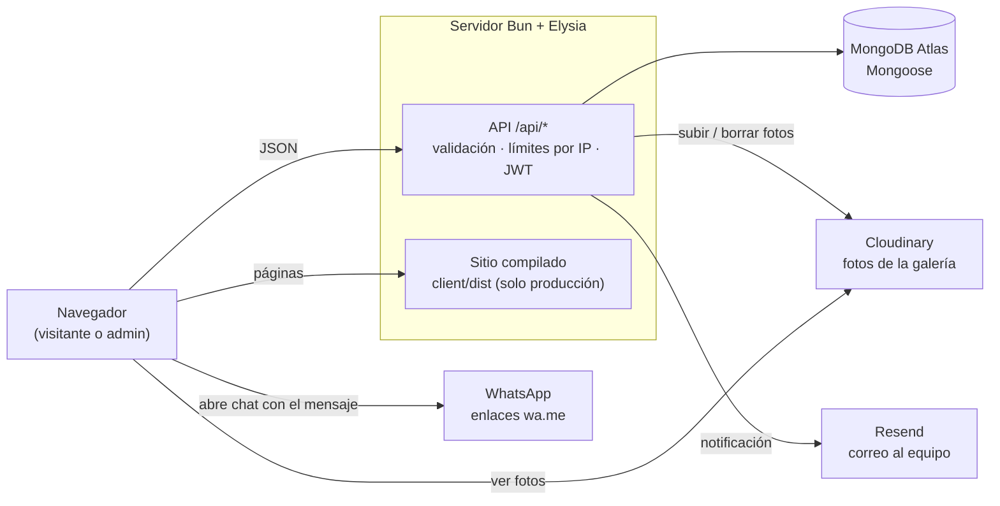

# Show Company — sitio web y panel de cotizaciones

Sitio web de **Show Company** (producción de eventos y entretenimiento en Guatemala) con:

- **Sitio público:** Inicio, Servicios (catálogo con precios), Cotizador (estimado inmediato),
  Galería, Nosotros y Contacto.
- **Cotizador:** el visitante elige personajes y actos, ve el estimado y lo confirma; la
  solicitud se guarda y se abre WhatsApp con el detalle.
- **Panel administrativo** (`/admin`): bandeja de solicitudes con su estado y gestión de las
  fotos de la galería.
- **Notificaciones:** cada solicitud nueva llega por correo al equipo.

Esta guía explica cómo instalarlo y correrlo. Los detalles están en [`docs/`](#documentación).

---

## Requisitos previos

| Qué | Para qué | Notas |
|---|---|---|
| [Bun](https://bun.sh) **1.4** o más reciente | Corre el backend, las pruebas y los scripts; instala dependencias | `bun --version` |
| Cuenta de [MongoDB Atlas](https://www.mongodb.com/atlas) | Base de datos | Necesitas la cadena de conexión y que **tu IP esté permitida** (Atlas → Security → Network Access) |
| Cuenta de [Cloudinary](https://cloudinary.com) | Fotos de la galería | Opcional para empezar: sin ella el sitio funciona, pero no se pueden subir fotos |
| Cuenta de [Resend](https://resend.com) | Correo de notificaciones | Opcional para empezar: sin ella las solicitudes se guardan pero no llega correo |

Para correr **las pruebas** no hace falta ninguna cuenta: usan una base de datos temporal en
memoria (la primera vez se descarga MongoDB, así que necesitas internet).

---

## Instalación

```bash
# 1. Clonar
git clone https://github.com/Dhidel/events_web_page.git
cd events_web_page
git switch BACKEND        # rama de trabajo actual

# 2. Dependencias: el backend (raíz) y el frontend (client/) se instalan por separado
bun install
cd client && bun install && cd ..

# 3. Variables de entorno del backend
cp .env.example .env
#    → genera JWT_SECRET y pégalo en .env (JWT_SECRET=...). No lo dejes vacío: ni el
#      servidor ni las pruebas arrancan con JWT_SECRET vacío.
bun -e "console.log(require('crypto').randomBytes(48).toString('hex'))"
#    → pon también tu MONGODB_URI (ver la tabla de abajo)

# 4. (Opcional) Número de WhatsApp de la empresa para el frontend: va en client/.env
#    echo "VITE_WHATSAPP_PHONE=50200000000" > client/.env

# 5. Cargar el catálogo de servicios y crear tu usuario del panel
bun run seed-servicios
bun run create-admin
```

`seed-servicios` crea solo los servicios que falten (no duplica ni cambia precios), así que se
puede correr más de una vez. **No uses `--force`** contra una base con datos reales: borra el
catálogo completo.

---

## Variables de entorno

Van en `.env` en la raíz (backend). `.env` nunca se sube al repositorio. `.env.example` tiene
cada variable comentada; los valores de abajo son **ejemplos falsos**.

| Variable | Obligatoria | Para qué sirve | Ejemplo (falso) |
|---|---|---|---|
| `MONGODB_URI` | **Sí** | Conexión a MongoDB Atlas. Sin ella el servidor no arranca. | `mongodb+srv://<usuario>:<password>@<cluster>.mongodb.net/<base>` |
| `JWT_SECRET` | **Sí** | Firma las sesiones del panel admin (duran 12 h). Sin ella el servidor no arranca. | una cadena aleatoria larga (ver `.env.example`) |
| `PORT` | No | Puerto del servidor. En desarrollo déjalo en 3000 (el frontend lo llama ahí). | `3000` |
| `NODE_ENV` | No | `production` sirve el frontend compilado, apaga `/swagger` y activa los headers de seguridad. | `development` |
| `CORS_ORIGIN` | En producción, si el frontend está en otro dominio | Dominios que pueden llamar a la API, separados por coma. | `https://www.ejemplo.com` |
| `SITE_URL` | Recomendada en producción | Dominio público: `sitemap.xml`, URL canónica y vista previa al compartir. | `https://www.ejemplo.com` |
| `CLOUDINARY_CLOUD_NAME` | Para la galería | Cuenta de Cloudinary. | `mi-cuenta` |
| `CLOUDINARY_API_KEY` | Para la galería | Clave de Cloudinary. | `000000000000000` |
| `CLOUDINARY_API_SECRET` | Para la galería | Secreto de Cloudinary. | `xxxxxxxxxxxxxxxx` |
| `CLOUDINARY_FOLDER` | No | Carpeta de las fotos en Cloudinary. | `show-company/gallery` |
| `RESEND_API_KEY` | Para el correo | Clave de Resend. | `re_xxxxxxxx` |
| `EMAIL_FROM` | No | Remitente. Por defecto `onboarding@resend.dev` (solo envía al dueño de la cuenta). | `notificaciones@ejemplo.com` |
| `EMAIL_TO_NOTIFY` | En producción | Quién recibe las notificaciones. **Una sola dirección**; si está vacía se usa una de desarrollo. | `ventas@ejemplo.com` |
| `CLIENT_IP_HEADER` | En el hosting (esta o la siguiente) | Header donde el hosting pone la IP real del visitante. | `cf-connecting-ip` |
| `TRUST_PROXY_HOPS` | En el hosting (esta o la anterior) | Proxies de confianza delante del servidor. | `1` |
| `RATE_LIMIT_COTIZACIONES_MAX` / `_VENTANA_MIN` | No | Envíos por IP a cotizaciones / ventana en minutos. | `5` / `10` |
| `RATE_LIMIT_LOGIN_MAX` / `_VENTANA_MIN` | No | Logins fallidos por IP / ventana en minutos. | `10` / `15` |
| `TEST_ADMIN_EMAIL` / `TEST_ADMIN_PASSWORD` | Solo para `bun run test-login` | Un admin de **prueba**. | `admin.prueba@ejemplo.com` |
| `WHATSAPP_PHONE`, `WHATSAPP_API_TOKEN` | — | **Sin efecto hoy** (las leen funciones que no se usan). | — |

**Frontend:** `VITE_WHATSAPP_PHONE` (número de WhatsApp de la empresa) va en **`client/.env`**,
no en el `.env` de la raíz. Ver [docs/cotizador-e-integraciones.md](docs/cotizador-e-integraciones.md#whatsapp).

---

## Correr en desarrollo

Dos terminales:

```bash
# Terminal 1 — backend (API) en http://localhost:3000, se reinicia al guardar
bun run dev

# Terminal 2 — frontend (Vite) en http://localhost:5173
cd client
bun run dev
```

- Abre **http://localhost:5173**. El panel está en http://localhost:5173/admin.
- El frontend llama a la API en `http://localhost:3000`, y la API solo acepta llamadas desde
  `http://localhost:5173`: si Vite arranca en otro puerto (por ejemplo 5174 porque el 5173 está
  ocupado), cierra lo que lo ocupa y vuelve a arrancarlo.
- **Swagger** (documentación interactiva de la API): http://localhost:3000/swagger. Solo
  existe en desarrollo. Para entrar a las rutas del panel, obtén un token con
  `POST /api/auth/login` y pégalo en **Authorize**.

## Correr en modo producción (local)

En producción un solo proceso sirve la API y el sitio compilado (`client/dist`):

```bash
cd client && bun run build && cd ..     # genera client/dist (obligatorio)
NODE_ENV=production bun run start        # http://localhost:3000
```

Sin `client/dist` el servidor no arranca en modo producción. Qué cambia en producción (headers,
404, sitemap, compresión): [docs/seguridad-y-operacion.md](docs/seguridad-y-operacion.md).

---

## Pruebas y revisiones

```bash
cd client && bun run build && cd ..   # una vez antes de las pruebas: genera client/dist
bun test              # pruebas del backend y de la lógica del frontend (MongoDB en memoria)
bun run typecheck     # TypeScript: backend, pruebas del navegador y client/
bun audit             # vulnerabilidades de dependencias (raíz)
cd client && bun audit && cd ..   # vulnerabilidades del frontend
```

- Las pruebas nunca usan Atlas ni mandan correos: corren contra una base temporal en memoria
  (`mongodb-memory-server`) y con Resend y Cloudinary simulados (`tests/setup.ts`).
- **Necesitan `client/dist`:** algunas arrancan el servidor real en modo producción, que sirve
  el sitio compilado. En un clon recién hecho, compila el cliente antes de `bun test`.
- **No necesitan `.env`.** Si ya creaste uno, `JWT_SECRET` no puede estar vacío.

### Problemas comunes

| Síntoma | Causa y solución |
|---|---|
| `Falta la variable de entorno JWT_SECRET` (al arrancar o en las pruebas) | `JWT_SECRET` está vacío en `.env`: genera uno (paso 3 de la instalación). |
| Pruebas de "servidor real en producción" fallan con `ENOENT` | Falta `client/dist`: `cd client && bun run build`. |
| `bun install` termina con `failed to enqueue lifecycle scripts for bcrypt` o deja carpetas vacías en `node_modules` | La caché de Bun de tu computadora está dañada: `bun pm cache rm`, borra `node_modules` y vuelve a instalar. |
| `MongoServerSelectionError` al arrancar el backend | Tu IP no está permitida en Atlas (Security → Network Access) o la red bloquea el puerto 27017. |
| La API falla por CORS en desarrollo | Vite no está en el puerto 5173 (estaba ocupado). Libera el puerto y reinicia Vite. |

---

## Scripts de operación

Se corren desde la raíz y usan la base de `MONGODB_URI` del `.env`. Revisa a qué base apunta
antes de correrlos.

| Comando | Qué hace | ¿Escribe en la base? |
|---|---|---|
| `bun run create-admin` | Crea un usuario del panel (pide correo, nombre y contraseña). Rechaza correos repetidos. | Sí |
| `bun run seed-servicios` | Carga el catálogo de 15 servicios. Solo agrega los que falten; no cambia precios existentes. `--force` borra todo el catálogo: no usarlo en producción. | Sí |
| `bun run seed-gallery` | Sube a Cloudinary las fotos de `client/imagenes-originales/` y las agrega a la galería. Si la galería ya tiene fotos no hace nada; `--force` la vacía. Necesita Cloudinary. | Sí |
| `bun run revocar-sesiones` | Cierra todas las sesiones de un admin (pide su correo). | Sí |
| `bun run test-login` | Prueba el login contra el servidor en `localhost:3000` con `TEST_ADMIN_EMAIL`/`TEST_ADMIN_PASSWORD`. El backend tiene que estar corriendo. | No |
| `bun run src/scripts/init-db.ts` | Crea en la base los índices de los modelos (`syncIndexes`). | Sí (índices) |
| `bun run src/scripts/verify-indexes.ts` | Muestra si cada consulta frecuente usa un índice. | No |
| `bun run src/scripts/test-email.ts` | Manda un correo **real** de prueba a `EMAIL_TO_NOTIFY`. Necesita Resend. | No |
| `bun run imagenes` (dentro de `client/`) | Regenera las versiones optimizadas de las fotos del sitio. | No |

---

## Estructura de carpetas

```
events_web_page/
├── src/                    Backend (Bun + Elysia + TypeScript)
│   ├── index.ts            Arranque: rutas, CORS/seguridad, Swagger (dev) y frontend (prod)
│   ├── db.ts               Conexión a MongoDB
│   ├── routes/             Endpoints de la API (público, auth y /api/admin/*)
│   ├── services/           Lógica: cotizador, solicitudes, correo, galería, WhatsApp
│   ├── models/             Modelos de Mongoose (Servicio, Solicitud, GalleryImage, AdminUser)
│   ├── middleware/         adminGuard: protege /api/admin/*
│   ├── plugins/            JWT del panel
│   ├── lib/                Validación, errores, seguridad HTTP, límites por IP, SEO, Cloudinary, Resend
│   └── scripts/            Scripts de operación (tabla de arriba)
├── client/                 Frontend (React + Vite)
│   ├── src/pages/          Páginas del sitio y del panel
│   ├── src/components/     Header, Footer, Lightbox, Foto, CampoTrampa…
│   ├── src/lib/ · utils/   API, validaciones, WhatsApp, Cloudinary
│   ├── src/data/           Textos fijos: títulos y descripciones de cada página, tipos de evento
│   ├── src/assets/         Imágenes optimizadas y fuentes
│   ├── imagenes-originales/  Fotos originales (fuente de "bun run imagenes")
│   └── public/             Archivos servidos tal cual (favicon, imagen para compartir)
├── tests/                  Pruebas (bun test) con MongoDB en memoria
├── docs/                   Documentación detallada
├── .env.example            Variables de entorno del backend, comentadas
└── Dockerfile              Imagen de contenedor (ver Deployment)
```

---

## Arquitectura



- **Backend:** Bun + Elysia + TypeScript. Las rutas (`src/routes`) validan la entrada y llaman a
  los servicios (`src/services`), que usan los modelos de Mongoose (`src/models`). Los errores
  siempre salen como `{ "error": "mensaje" }` sin detalles internos.
- **Base de datos:** MongoDB Atlas, con Mongoose. Esquemas y endpoints: Swagger
  (`/swagger`, en desarrollo).
- **Frontend:** React + React Router + Vite en `client/`. En desarrollo corre en Vite
  (puerto 5173) y llama a la API en el puerto 3000. **En producción el backend sirve
  `client/dist`** y escribe en el `<head>` de cada página su título, descripción y vista previa
  (SEO), además de `robots.txt` y `sitemap.xml`.
- **Panel admin:** contraseñas con **bcrypt**; sesión con **JWT** de 12 horas, revocable.
- **Cloudinary:** guarda las fotos de la galería; el servidor sube y borra, el navegador las
  pide optimizadas.
- **Resend:** el servidor manda un correo al equipo por cada solicitud nueva.
- **WhatsApp:** sin API; el sitio arma enlaces `wa.me` con el mensaje listo.

---

## Documentación

| Documento | Contenido |
|---|---|
| [docs/cotizador-e-integraciones.md](docs/cotizador-e-integraciones.md) | Reglas del cotizador (fórmula, límites, batucadas, texto legal, lo que no está implementado) y configuración de Resend y WhatsApp |
| [docs/seguridad-y-operacion.md](docs/seguridad-y-operacion.md) | CORS, HTTPS y headers de seguridad, sesión del panel, límite por IP y anti-spam, errores, qué sirve el servidor en producción y optimización de imágenes |
| Swagger (`http://localhost:3000/swagger`, solo en desarrollo) | Cada endpoint de la API con sus datos de entrada y respuestas |

---

## Deployment

Se documenta en el ticket **[17.4]**.
