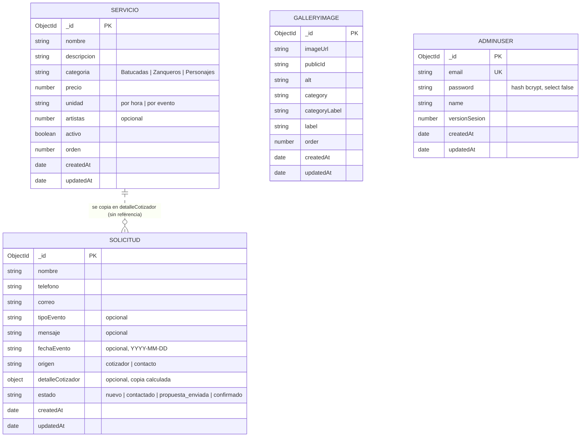

# Base de datos y API

Qué guarda la base de datos y qué hace cada endpoint de la API, sin tener que leer el código.
Todo sale de `src/models/`, `src/routes/`, `src/index.ts`, `src/lib/apiSchemas.ts`,
`src/lib/validation.ts`, `src/lib/errors.ts`, `src/lib/limiteSolicitudes.ts` y
`src/middleware/adminGuard.ts`. Si cambias alguno de esos archivos, actualiza este documento.

Todos los ejemplos usan datos falsos.

- [1. Base de datos](#1-base-de-datos)
  - [Diagrama](#diagrama)
  - [servicios](#servicios)
  - [solicituds](#solicituds)
  - [galleryimages](#galleryimages)
  - [adminusers](#adminusers)
  - [Relaciones y datos sensibles](#relaciones-y-datos-sensibles)
- [2. API](#2-api)
  - [Reglas comunes](#reglas-comunes)
  - [Endpoints públicos](#endpoints-públicos)
  - [Endpoints del panel admin](#endpoints-del-panel-admin)
- [3. Más información](#3-más-información)

---

## 1. Base de datos

MongoDB (Atlas) con Mongoose. Hay cuatro colecciones, una por modelo. Mongoose les pone el
nombre del modelo en minúsculas y en plural **en inglés** (agrega una `s`), por eso la colección de
`Solicitud` se llama `solicituds` y no `solicitudes`.

| Modelo (`src/models/`) | Colección | Para qué sirve |
|---|---|---|
| `Servicio` | `servicios` | Catálogo de personajes y actos (batucadas, zanqueros, personajes) con su precio. Lo usan las páginas Servicios y Cotizador. |
| `Solicitud` | `solicituds` | Solicitudes de cotización que llegan del formulario de Contacto y del Cotizador. El panel admin las lista y les cambia el estado. |
| `GalleryImage` | `galleryimages` | Fotos de la galería del sitio. La imagen vive en Cloudinary; aquí se guarda su URL y su `publicId`. |
| `AdminUser` | `adminusers` | Usuarios del panel admin (correo, contraseña con bcrypt, nombre). |

Lo común a las cuatro:

- `_id` (ObjectId) lo genera MongoDB. Todas usan `timestamps: true`, así que tienen
  `createdAt` y `updatedAt` (Date) que Mongoose llena solo.
- En las respuestas de la API (`toJSON` de `servicios`, `solicituds` y `galleryimages`), `_id`
  sale como texto, se agrega `id` (el mismo valor) y se quita `__v`.
- Los campos de texto con `trim` se guardan sin espacios al inicio ni al final.

### Diagrama



La línea punteada no es una referencia de Mongoose (`ref`): la solicitud guarda una **copia** de
los datos del servicio en el momento de cotizar. `galleryimages` y `adminusers` no se relacionan
con ninguna otra colección.

### servicios

Catálogo de servicios. **La API no tiene endpoints para crear, editar ni borrar servicios**: se
cargan con `bun run seed-servicios` (`src/scripts/seed-servicios.ts`). Un servicio con
`activo: false` queda oculto en el sitio sin borrarse.

| Campo | Tipo | Obligatorio | Por defecto | Valores permitidos / límites |
|---|---|---|---|---|
| `nombre` | String | Sí | — | `trim` |
| `descripcion` | String | Sí | — | `trim` |
| `categoria` | String | Sí | — | `Batucadas`, `Zanqueros`, `Personajes` |
| `precio` | Number | Sí | — | mínimo `0`. En quetzales, por personaje (o por grupo si tiene `artistas`), dentro de la Ciudad Capital |
| `unidad` | String | Sí | `"por hora"` | `por hora`, `por evento` |
| `artistas` | Number | No | — | entero, mínimo `1`. Artistas incluidos en el precio cuando el servicio es un grupo (p. ej. una batucada de 3) |
| `activo` | Boolean | No | `true` | `false` = oculto en el sitio |
| `orden` | Number | No | `0` | posición en el catálogo |

Índices:

| Índice | Para qué consulta |
|---|---|
| `{ activo: 1, orden: 1, createdAt: 1 }` | `GET /api/servicios` sin filtro: servicios activos ordenados por `orden` y, a igual orden, por fecha. |
| `{ activo: 1, categoria: 1, orden: 1, createdAt: 1 }` | `GET /api/servicios?categoria=...`: la misma consulta filtrada por categoría. |

### solicituds

Solicitudes de cotización. Se crean solo con `POST /api/cotizaciones` y el panel solo puede
cambiarles el `estado` (no se editan ni se borran desde la API).

| Campo | Tipo | Obligatorio | Por defecto | Valores permitidos / límites en el modelo | Validación extra en la API (`POST /api/cotizaciones`) |
|---|---|---|---|---|---|
| `nombre` | String | Sí | — | `trim` | 2 a 120 caracteres, no solo espacios |
| `telefono` | String | Sí | — | `trim` | 7 a 20 caracteres (dígitos, espacios, `+`, `-`, `(`, `)`, `.`) con al menos 7 dígitos |
| `correo` | String | Sí | — | `trim`, `lowercase` | formato de correo, máximo 150 |
| `tipoEvento` | String | No | — | `trim` | máximo 100 |
| `mensaje` | String | No | — | `trim` | máximo 2000 |
| `fechaEvento` | String | No | — | debe cumplir `YYYY-MM-DD` | además debe ser un día que exista (`2026-02-31` se rechaza) |
| `origen` | String | Sí | — | `cotizador`, `contacto` | — |
| `detalleCotizador` | Mixed (objeto libre) | No | — | sin esquema en el modelo | solo se guarda con `origen: "cotizador"`; lo arma el servidor (ver abajo) |
| `estado` | String | Sí | `"nuevo"` | `nuevo`, `contactado`, `propuesta_enviada`, `confirmado` | — |

Los largos máximos **solo los valida la API**: el modelo no tiene `maxlength`. Antes de guardar,
`src/services/solicitud.service.ts` les quita el HTML a los textos (`sanitizeText`).

`fechaEvento` se guarda como texto y no como `Date` porque es un día del calendario, no un
instante: así no cambia con la zona horaria.

Forma de `detalleCotizador` (la calcula `src/services/cotizador.service.ts` con los precios de
MongoDB; nunca se guarda lo que manda el navegador):

```json
{
  "personajes": [
    {
      "servicioId": "6ab45b6121f69b5836d36221",
      "nombre": "Batucada de ejemplo — 3 tamboreros",
      "cantidad": 2,
      "precioUnitario": 3800,
      "subtotal": 7600
    }
  ],
  "total": 7600
}
```

Índices:

| Índice | Para qué consulta |
|---|---|
| `{ createdAt: -1 }` | `GET /api/admin/cotizaciones` sin filtro: más recientes primero. También ayuda a la búsqueda de duplicados recientes al crear una solicitud. |
| `{ estado: 1, createdAt: -1 }` | `GET /api/admin/cotizaciones?estado=...`: filtra por estado y ordena por fecha. Como `estado` es el prefijo, no hace falta otro índice solo de `estado`. |

### galleryimages

Fotos de la galería. Se administran desde el panel (`/api/admin/gallery`) o con
`bun run seed-gallery`.

| Campo | Tipo | Obligatorio | Por defecto | Valores permitidos / límites en el modelo | Validación extra en la API |
|---|---|---|---|---|---|
| `imageUrl` | String | Sí | — | — | la pone el servidor (URL de Cloudinary) |
| `publicId` | String | Sí | — | — | la pone el servidor; sirve para reemplazar o borrar la imagen en Cloudinary |
| `alt` | String | Sí | — | `trim` | 1 a 200 caracteres, no solo espacios, sin HTML |
| `category` | String | Sí | — | `quinceaneras`, `bodas`, `corporativo`, `navidad`, `espectaculos` | — |
| `categoryLabel` | String | Sí | — | `trim` | no se envía: el servidor la deriva de `category` |
| `label` | String | Sí | — | `trim` | 1 a 150 caracteres, no solo espacios, sin HTML |
| `order` | Number | No | `0` | — | número (sin mínimo ni máximo) |

Etiquetas que se derivan de `category`: `quinceaneras` → "Quinceaños", `bodas` → "Bodas",
`corporativo` → "Corporativo", `navidad` → "Navidad", `espectaculos` → "Espectáculos".

Índices:

| Índice | Para qué consulta |
|---|---|
| `{ order: 1, createdAt: 1 }` | `GET /api/gallery` y `GET /api/admin/gallery`: toda la galería ordenada por `order` y, a igual orden, por fecha. |
| `{ category: 1, order: 1, createdAt: 1 }` | Filtrar por categoría con el mismo orden. **Hoy ningún endpoint filtra por categoría** (lo hace el frontend); el índice queda preparado y lo revisa `src/scripts/verify-indexes.ts`. |

### adminusers

Usuarios del panel. Se crean con `bun run create-admin`; la API no tiene endpoints para
crearlos ni listarlos.

| Campo | Tipo | Obligatorio | Por defecto | Valores permitidos / límites |
|---|---|---|---|---|
| `email` | String | Sí | — | único, `trim`, `lowercase` |
| `password` | String | Sí | — | se guarda como hash de **bcrypt** (10 rondas) al hacer `save()`. `select: false`: no sale en ninguna consulta salvo que se pida explícitamente (solo lo hace el login) |
| `name` | String | Sí | — | `trim` |
| `versionSesion` | Number | No | `0` | va dentro de cada JWT (claim `v`). Subirla con `bun run revocar-sesiones` invalida todos los tokens ya emitidos de ese admin |

Índices:

| Índice | Para qué consulta |
|---|---|
| `{ email: 1 }` único (por `unique: true`) | El login busca al admin por correo; además impide dos admins con el mismo correo. |

La verificación de la sesión en cada ruta admin busca por `_id` y `versionSesion` (usa el índice
de `_id`).

### Relaciones y datos sensibles

**Relaciones**

- Ninguna colección usa `ref` ni `populate`: no hay referencias de Mongoose entre colecciones.
- `solicituds.detalleCotizador` guarda una **copia** del cálculo: `servicioId` (como texto),
  `nombre`, `cantidad`, `precioUnitario` y `subtotal` de cada línea, más el `total`. Si después
  cambia el precio de un servicio, se desactiva o se borra, las solicitudes ya guardadas no
  cambian: muestran lo que se cotizó ese día.
- `galleryimages.publicId` apunta a la imagen en Cloudinary (servicio externo), no a otra
  colección.

**Datos sensibles**

| Dónde | Qué | Cómo se protege |
|---|---|---|
| `adminusers.password` | Contraseña del panel | Solo se guarda el hash de bcrypt; `select: false`; ningún endpoint lo devuelve. |
| `adminusers.email` | Correo del admin | Solo lo devuelve `GET /api/admin/me` (con JWT). El login responde el mismo error para correo inexistente y contraseña incorrecta. |
| `solicituds` (`nombre`, `telefono`, `correo`, `mensaje`, `fechaEvento`) | Datos personales de clientes | Solo se leen con JWT (`/api/admin/cotizaciones`). Los logs de errores los enmascaran (`safeErrorLog`). Se envían por correo al equipo con Resend. |
| `galleryimages` | Nada sensible | Es contenido público; `/api/gallery` devuelve todos los campos, incluido `publicId`. |

La cadena de conexión (`MONGODB_URI`) y el secreto del JWT (`JWT_SECRET`) van en `.env` y nunca
en la base ni en las respuestas.

---

## 2. API

### Reglas comunes

- **Base:** en desarrollo `http://localhost:3000`. En producción el mismo servidor sirve la API y
  el sitio.
- **Formato:** JSON, salvo las subidas de la galería (`multipart/form-data`).
- **Autenticación del panel:** header `Authorization: Bearer <token>`, con el token de
  `POST /api/auth/login` (dura 12 horas). Todas las rutas `/api/admin/*` lo exigen.
- **Campos extra:** los cuerpos no aceptan campos que no estén en el esquema: responden 422
  `"Campos no permitidos: campo1, campo2."`.
- **Formato de error:** siempre `{"error": "mensaje"}`, sin detalles internos. La única excepción
  es el 413.

Códigos de error y qué los provoca:

| Código | Cuándo | Mensaje (`error`) |
|---|---|---|
| 400 | El cuerpo no es JSON / FormData válido | `"El cuerpo de la solicitud no tiene un formato válido."` |
| 401 | Ruta admin sin token, con token inválido, expirado o revocado (admin borrado o `versionSesion` cambiada). En el login: credenciales incorrectas | `"No autorizado."` / `"Correo o contraseña incorrectos."` |
| 404 | El id no existe, o la ruta `/api/*` no existe | `"Solicitud no encontrada."`, `"Imagen no encontrada."`, `"Ruta no encontrada."` |
| 413 | El cuerpo pasa de 12 MB. Lo responde Bun antes de llegar a la API, **sin cuerpo y sin el formato `{ error }`** | — |
| 422 | Datos inválidos o faltantes, campos no permitidos, id con formato inválido, archivo que no es imagen | `"Datos inválidos o faltantes: correo."`, `"Campos no permitidos: extra."`, `"El id no es válido."`, `"El archivo debe ser una imagen JPG, PNG o WebP."` |
| 429 | Se pasó el límite por IP (cotizaciones o login). Trae el header `Retry-After` con los segundos de espera | ver cada endpoint |
| 500 | Error inesperado (el detalle queda solo en el log) | `"Ocurrió un error, intenta de nuevo."` |
| 502 | Falló Cloudinary al subir una imagen | `"No se pudo procesar la imagen. Intenta de nuevo."` |

Los mensajes de 422 nombran los campos con problema, pero nunca repiten los valores enviados.

**Orden de las validaciones:** primero se lee el cuerpo (400), después se revisa el token en las
rutas admin (401) y después se validan los datos (422). Una petición sin token recibe 401 y no un
422 que describa el esquema, salvo que el cuerpo ni siquiera se pueda leer (ahí responde 400).

#### Resumen de endpoints

| Método | Ruta | Acceso | Para qué |
|---|---|---|---|
| GET | `/api/health` | Público | Estado del servidor |
| GET | `/api/servicios` | Público | Catálogo de servicios activos |
| GET | `/api/gallery` | Público | Fotos de la galería |
| POST | `/api/cotizaciones` | Público (límite por IP) | Enviar una solicitud de Contacto o del Cotizador |
| POST | `/api/auth/login` | Público (límite por IP) | Iniciar sesión en el panel |
| GET | `/api/admin/me` | JWT | Datos del admin con sesión activa |
| GET | `/api/admin/cotizaciones` | JWT | Listar solicitudes |
| PATCH | `/api/admin/cotizaciones/:id` | JWT | Cambiar el estado de una solicitud |
| GET | `/api/admin/gallery` | JWT | Listar fotos (panel) |
| POST | `/api/admin/gallery` | JWT | Subir una foto |
| PUT | `/api/admin/gallery/:id` | JWT | Editar una foto |
| DELETE | `/api/admin/gallery/:id` | JWT | Borrar una foto |

Además existe `GET /ping`, que responde el texto `pong` (no JSON). No tiene descripción en
Swagger y el frontend no lo usa; para comprobar el servidor usa `/api/health`.

---

### Endpoints públicos

#### `GET /api/health`

Responde si el servidor está arriba. No consulta la base.

```http
GET /api/health
```

```json
200
{ "status": "ok" }
```

#### `GET /api/servicios`

Catálogo de servicios **activos** (`activo: true`), ordenados por `orden`. Lo usan las páginas
Servicios y Cotizador.

| Parámetro | Dónde | Obligatorio | Valores |
|---|---|---|---|
| `categoria` | query | No | `Batucadas`, `Zanqueros` o `Personajes` (exacto) |

```http
GET /api/servicios?categoria=Batucadas
```

```json
200
[
  {
    "_id": "6ab45b6121f69b5836d36221",
    "id": "6ab45b6121f69b5836d36221",
    "nombre": "Batucada de ejemplo — 3 tamboreros",
    "descripcion": "Descripción de ejemplo del servicio",
    "categoria": "Batucadas",
    "precio": 3800,
    "unidad": "por hora",
    "artistas": 3,
    "activo": true,
    "orden": 0,
    "createdAt": "2026-09-23T23:06:09.856Z",
    "updatedAt": "2026-09-23T23:06:09.856Z"
  }
]
```

| Código | Causa |
|---|---|
| 422 | `categoria` no es uno de los tres valores (`"Datos inválidos o faltantes: categoria."`) |
| 500 | Error inesperado |

#### `GET /api/gallery`

Todas las fotos de la galería, ordenadas por `order` (y por fecha a igual orden). No tiene
parámetros: el filtro por categoría lo hace el frontend.

```http
GET /api/gallery
```

```json
200
[
  {
    "_id": "6ab3f0c2a1b2c3d4e5f60718",
    "id": "6ab3f0c2a1b2c3d4e5f60718",
    "imageUrl": "https://res.cloudinary.com/demo/image/upload/v1/ejemplo/foto.jpg",
    "publicId": "ejemplo/foto",
    "alt": "Texto alternativo de ejemplo",
    "category": "quinceaneras",
    "categoryLabel": "Quinceaños",
    "label": "Título de ejemplo",
    "order": 0,
    "createdAt": "2026-09-20T18:00:00.000Z",
    "updatedAt": "2026-09-20T18:00:00.000Z"
  }
]
```

| Código | Causa |
|---|---|
| 500 | Error inesperado |

#### `POST /api/cotizaciones`

Guarda una solicitud del formulario de Contacto o del Cotizador, con estado `"nuevo"`, y avisa al
equipo por correo (si el correo falla, la solicitud igual queda guardada).

Cuerpo (JSON):

| Campo | Obligatorio | Reglas |
|---|---|---|
| `nombre` | Sí | 2 a 120 caracteres, no solo espacios |
| `telefono` | Sí | 7 a 20 caracteres (dígitos, espacios, `+`, `-`, `(`, `)`, `.`), al menos 7 dígitos |
| `correo` | Sí | formato de correo, máximo 150 |
| `tipoEvento` | No | máximo 100 |
| `mensaje` | No | máximo 2000 |
| `fechaEvento` | No | `"YYYY-MM-DD"` y un día que exista |
| `origen` | Sí | `"contacto"` o `"cotizador"` |
| `detalleCotizador` | Solo con `origen: "cotizador"` | `{ personajes: [...], total? }`. Cada personaje: `servicioId` (24 caracteres hex), `cantidad` (entero de 0 a 20, enviado como número, no como texto), `nombre?` (máx. 200), `subtotal?`. Máximo 50 personajes |
| `sitioWeb` | No | campo trampa (honeypot), debe ir vacío u omitido |

Cómo se procesa:

- Con `origen: "cotizador"`, el servidor **ignora** `nombre`, `subtotal` y `total` que manda el
  navegador y recalcula todo con los precios actuales de MongoDB. Las líneas con cantidad 0 se
  descartan. Con `origen: "contacto"`, `detalleCotizador` se descarta.
- Una solicitud idéntica a otra de los últimos 10 minutos no se guarda de nuevo: responde 201 con
  la que ya existía y no manda otro correo.
- Si `sitioWeb` trae texto, responde 201 con una solicitud de apariencia normal pero **no guarda
  nada ni manda correo**.
- Los textos se guardan sin HTML. Si un campo queda vacío al quitarle el HTML
  (p. ej. `"<b></b>"`), responde 422.

Ejemplo (Cotizador):

```http
POST /api/cotizaciones
Content-Type: application/json

{
  "nombre": "Cliente de Ejemplo",
  "telefono": "50200000000",
  "correo": "cliente@ejemplo.com",
  "tipoEvento": "Cumpleaños",
  "origen": "cotizador",
  "detalleCotizador": {
    "personajes": [
      { "servicioId": "6ab45b6121f69b5836d36221", "cantidad": 2 }
    ]
  }
}
```

```json
201
{
  "_id": "6ab4600a9f8e7d6c5b4a3921",
  "id": "6ab4600a9f8e7d6c5b4a3921",
  "nombre": "Cliente de Ejemplo",
  "telefono": "50200000000",
  "correo": "cliente@ejemplo.com",
  "tipoEvento": "Cumpleaños",
  "origen": "cotizador",
  "detalleCotizador": {
    "personajes": [
      {
        "servicioId": "6ab45b6121f69b5836d36221",
        "nombre": "Batucada de ejemplo — 3 tamboreros",
        "cantidad": 2,
        "precioUnitario": 3800,
        "subtotal": 7600
      }
    ],
    "total": 7600
  },
  "estado": "nuevo",
  "createdAt": "2026-09-23T20:15:00.000Z",
  "updatedAt": "2026-09-23T20:15:00.000Z"
}
```

Ejemplo (Contacto):

```json
{
  "nombre": "Cliente de Ejemplo",
  "telefono": "50200000000",
  "correo": "cliente@ejemplo.com",
  "tipoEvento": "Boda",
  "mensaje": "Mensaje de ejemplo.",
  "fechaEvento": "2026-12-05",
  "origen": "contacto"
}
```

| Código | Causa |
|---|---|
| 400 | El cuerpo no es JSON válido |
| 413 | El cuerpo pasa de 12 MB (sin formato `{ error }`) |
| 422 | Campo faltante o inválido (`"Datos inválidos o faltantes: telefono."`); campos no permitidos; `fechaEvento` que no existe; `origen: "cotizador"` sin `detalleCotizador`; una `cantidad` enviada como texto. Errores del cálculo: `"Selecciona al menos un personaje."`, `"Uno de los personajes seleccionados ya no está disponible."` (servicio inexistente o inactivo), `"Un personaje aparece más de una vez en la cotización."` |
| 429 | Límite por IP: `"Recibimos varias solicitudes seguidas desde tu conexión. Espera unos minutos e intenta de nuevo."` + header `Retry-After` |
| 500 | Error inesperado |

**Límite por IP:** máximo **5 envíos cada 10 minutos** por IP (configurable con
`RATE_LIMIT_COTIZACIONES_MAX` y `RATE_LIMIT_COTIZACIONES_VENTANA_MIN`). El límite se revisa
después de validar el esquema del cuerpo: un envío con campos faltantes o mal formados (400/422)
no cuenta. Sí cuentan los duplicados, los del honeypot y los que fallan después por una
`fechaEvento` inexistente o una selección del cotizador inválida.

#### `POST /api/auth/login`

Inicia sesión en el panel y devuelve un JWT válido por 12 horas.

| Campo | Obligatorio | Reglas |
|---|---|---|
| `email` | Sí | texto, máximo 254 |
| `password` | Sí | texto, máximo 200 |

```http
POST /api/auth/login
Content-Type: application/json

{ "email": "admin@ejemplo.com", "password": "contraseña-de-ejemplo" }
```

```json
200
{ "token": "eyJhbGciOiJIUzI1NiJ9.ejemplo.firma" }
```

| Código | Causa |
|---|---|
| 400 | El cuerpo no es JSON válido |
| 401 | Correo inexistente, contraseña incorrecta, correo mal formado o contraseña vacía. Siempre el mismo mensaje: `"Correo o contraseña incorrectos."` (no revela si el correo existe) |
| 422 | `email` o `password` no son texto (p. ej. `{"$ne": null}`), superan el largo máximo, o hay campos no permitidos |
| 429 | Demasiados intentos fallidos: `"Demasiados intentos de inicio de sesión. Espera unos minutos e intenta de nuevo."` + header `Retry-After` |
| 500 | Error inesperado |

**Límite por IP:** después de **10 intentos fallidos (401) en 15 minutos** desde la misma IP,
responde 429 **aunque la contraseña sea correcta** (configurable con `RATE_LIMIT_LOGIN_MAX` y
`RATE_LIMIT_LOGIN_VENTANA_MIN`). Los inicios de sesión correctos no cuentan. El límite es por IP y
no por correo, para que nadie pueda bloquear al admin a propósito.

---

### Endpoints del panel admin

Todos requieren `Authorization: Bearer <token>`. Sin token, o con uno inválido, expirado o
revocado, responden **401** `{"error": "No autorizado."}`. Las rutas con `:id` esperan un id de
MongoDB (24 caracteres hex); otro formato responde 422 `"El id no es válido."`.

#### `GET /api/admin/me`

Devuelve el contenido del token del admin con sesión activa. Sirve para comprobar que el token
sigue siendo válido.

```http
GET /api/admin/me
Authorization: Bearer <token>
```

```json
200
{
  "admin": {
    "id": "6ab3e1f0c9d8b7a6f5e4d3c2",
    "email": "admin@ejemplo.com",
    "v": 0,
    "iat": 1789956800,
    "exp": 1790000000
  }
}
```

`v` es la versión de sesión (`versionSesion`); `iat` y `exp` son la fecha de emisión y de
vencimiento del token (segundos Unix).

| Código | Causa |
|---|---|
| 401 | Token faltante, inválido, expirado o revocado |
| 500 | Error inesperado |

#### `GET /api/admin/cotizaciones`

Lista las solicitudes de Contacto y Cotizador, más recientes primero.

| Parámetro | Dónde | Obligatorio | Valores |
|---|---|---|---|
| `estado` | query | No | `nuevo`, `contactado`, `propuesta_enviada`, `confirmado` |

```http
GET /api/admin/cotizaciones?estado=nuevo
Authorization: Bearer <token>
```

Respuesta 200: un arreglo de solicitudes, con la misma forma que la respuesta de
`POST /api/cotizaciones`.

| Código | Causa |
|---|---|
| 401 | Sin sesión válida |
| 422 | `estado` no es uno de los cuatro valores |
| 500 | Error inesperado |

#### `PATCH /api/admin/cotizaciones/:id`

Cambia el estado de seguimiento de una solicitud. Es lo único que se puede cambiar de una
solicitud.

| Parámetro | Dónde | Reglas |
|---|---|---|
| `id` | ruta | id de MongoDB |
| `estado` | cuerpo (JSON) | `nuevo`, `contactado`, `propuesta_enviada` o `confirmado` |

```http
PATCH /api/admin/cotizaciones/6ab4600a9f8e7d6c5b4a3921
Authorization: Bearer <token>
Content-Type: application/json

{ "estado": "contactado" }
```

Respuesta 200: la solicitud completa con el estado nuevo.

| Código | Causa |
|---|---|
| 400 | El cuerpo no es JSON válido |
| 401 | Sin sesión válida |
| 404 | No existe una solicitud con ese id (`"Solicitud no encontrada."`) |
| 422 | Id mal formado, `estado` inválido o faltante, campos no permitidos |
| 500 | Error inesperado |

#### `GET /api/admin/gallery`

Mismo contenido y forma que `GET /api/gallery`, para el panel.

| Código | Causa |
|---|---|
| 401 | Sin sesión válida |
| 500 | Error inesperado |

#### `POST /api/admin/gallery`

Sube una imagen a Cloudinary y la agrega a la galería. Cuerpo `multipart/form-data`:

| Campo | Obligatorio | Reglas |
|---|---|---|
| `image` | Sí | archivo JPG, PNG o WebP, máximo 10 MB (se revisan los bytes reales, no solo la extensión; SVG y GIF no se aceptan) |
| `alt` | Sí | 1 a 200 caracteres, no solo espacios; se guarda sin HTML |
| `label` | Sí | 1 a 150 caracteres, no solo espacios; se guarda sin HTML |
| `category` | Sí | `quinceaneras`, `bodas`, `corporativo`, `navidad`, `espectaculos` |
| `order` | No | número; por defecto `0` |

`categoryLabel`, `imageUrl` y `publicId` los pone el servidor.

```http
POST /api/admin/gallery
Authorization: Bearer <token>
Content-Type: multipart/form-data

image=@foto-de-ejemplo.jpg
alt=Texto alternativo de ejemplo
label=Título de ejemplo
category=bodas
order=1
```

Respuesta **201**: la foto creada, con la misma forma que un elemento de `GET /api/gallery`.

| Código | Causa |
|---|---|
| 400 | El cuerpo no es FormData válido |
| 401 | Sin sesión válida |
| 413 | El cuerpo pasa de 12 MB (sin formato `{ error }`) |
| 422 | Falta un campo, `category` inválida, archivo que no es JPG/PNG/WebP o pasa de 10 MB, `alt`/`label` que quedan vacíos sin HTML, campos no permitidos |
| 500 | Error inesperado |
| 502 | Cloudinary falló o no está configurado (`"No se pudo procesar la imagen. Intenta de nuevo."`) |

#### `PUT /api/admin/gallery/:id`

Edita una foto. Cuerpo `multipart/form-data` con los mismos campos que el `POST`, **todos
opcionales**: solo cambia lo que se envía. Si llega `image`, se sube la nueva a Cloudinary y se
borra la anterior. Si cambia `category`, también cambia `categoryLabel`.

```http
PUT /api/admin/gallery/6ab3f0c2a1b2c3d4e5f60718
Authorization: Bearer <token>
Content-Type: multipart/form-data

label=Título nuevo de ejemplo
order=2
```

Respuesta 200: la foto actualizada.

| Código | Causa |
|---|---|
| 400 | El cuerpo no es FormData válido |
| 401 | Sin sesión válida |
| 404 | No existe una foto con ese id (`"Imagen no encontrada."`) |
| 413 | El cuerpo pasa de 12 MB (sin formato `{ error }`) |
| 422 | Id mal formado o los mismos casos que en el `POST` |
| 500 | Error inesperado |
| 502 | Cloudinary falló al subir la imagen nueva |

#### `DELETE /api/admin/gallery/:id`

Borra la foto de la galería y de Cloudinary. Si Cloudinary falla al borrar, solo queda en el log:
la foto igual se borra de la base.

```http
DELETE /api/admin/gallery/6ab3f0c2a1b2c3d4e5f60718
Authorization: Bearer <token>
```

```json
200
{ "ok": true }
```

| Código | Causa |
|---|---|
| 401 | Sin sesión válida |
| 404 | No existe una foto con ese id (`"Imagen no encontrada."`) |
| 422 | Id mal formado |
| 500 | Error inesperado |

---

## 3. Más información

- **Swagger** (`http://localhost:3000/swagger`, la especificación en `/swagger/json`) es la
  referencia interactiva de la API: deja probar cada endpoint y se genera del mismo código. **Solo
  existe en desarrollo**; en producción no se publica. Para las rutas admin, obtén un token con
  `POST /api/auth/login` y pégalo en **Authorize**.
- [docs/cotizador-e-integraciones.md](cotizador-e-integraciones.md): reglas del cotizador
  (fórmula, batucadas, catálogo), correo de notificaciones con Resend y WhatsApp.
- [docs/seguridad-y-operacion.md](seguridad-y-operacion.md): CORS y headers de seguridad, sesión
  del panel y revocación, cómo se obtiene la IP para los límites (proxy, IPv6, `Retry-After`),
  errores seguros y qué sirve el servidor en producción.
